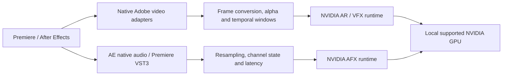

# How the suite fits together

## Source map

| Directory | Responsibility |
| --- | --- |
| `src/adobe` | Effect entry points, parameters, PiPL integration, SmartFX and native audio callbacks |
| `src/vst3` | Six stable VST3 processor/controller pairs, host parameters, state and latency |
| `src/core` | Pixel conversion, premultiplied alpha, image operations and audio block/resampling adapters |
| `src/nvidia` | GPU policy and dynamic AR/VFX/AFX loading, model paths and effect lifetimes |
| `src/tools` | Support diagnostics and standalone developer CLIs |
| `tests` | SDK-free DSP/policy, Adobe contract/GPU harnesses, installer and encryption fixtures |
| `installer` | Branded NSIS setup plus verified staging, deployment and receipt-based uninstall |
| `scripts` | Local SDK configuration/download helpers, build, release packaging and source audit |

## Video

Host pixel layouts are converted to the model's SDR representation. The adapters preserve source alpha, negative/padded row strides and untouched high-precision values. Soft segmentation is refined around uncertain edges. Auto Frame estimates a single subject's center. Large denoise frames use overlapping full-resolution tiles.

Highest Quality requests a bounded frame neighborhood explicitly and resets model state for an independent render window. Relighting has extra internal state, so its HQ handle is rebuilt per request. Preview reuse is restricted by context and timeline continuity. These decisions trade processing time for predictable host behavior.

The original Eye Contact adapter has its own AR engine and retained host format support. The six new video adapters share source but compile into separate native modules with stable match names. Their controls expose relevant settings and hide unrelated ones.

## Audio

Each channel has separate mono model state. A streaming band-limited resampler bridges host rates and SDK rates. Block adaptation, declared delay and zero-padding preserve duration and support arbitrary host buffer boundaries. Mix/gain ramps avoid abrupt control changes; bypass retains the source path.

Native AE audio requests fixed windows with pre-roll instead of relying on earlier host calls. VST3 processors expose generic host UI, persistent state, transport reset handling and reported latency. Studio Voice HQ is intended for offline rendering. Nominal latency compensation does not make a generative speech model phase-exact.

## Distribution

NVIDIA DLLs/models remain separate licensed runtime components. SDKs and tokens are never committed. Release packaging creates content-addressed ZIP parts, then wraps each in AES-256-CBC with encrypt-then-HMAC-SHA256. A random per-release key stays in ignored build storage and is embedded in Setup, not source control.

Setup checks supported hardware before offering installation, selects components and the detected GPU model family, downloads or locates encrypted assets, checks the embedded SHA-256 values, authenticates/decrypts and stages files. Per-file hashes are checked again before installation paths change. Deployment uses rollback records; uninstall removes owned, unchanged files and preserves additions/modifications.

The release key is recoverable from Setup. Models and DLLs must be readable at runtime. This envelope is not DRM, a developer-access barrier or a substitute for NVIDIA licensing. The public manifest is an inventory, not a standalone developer SDK.
